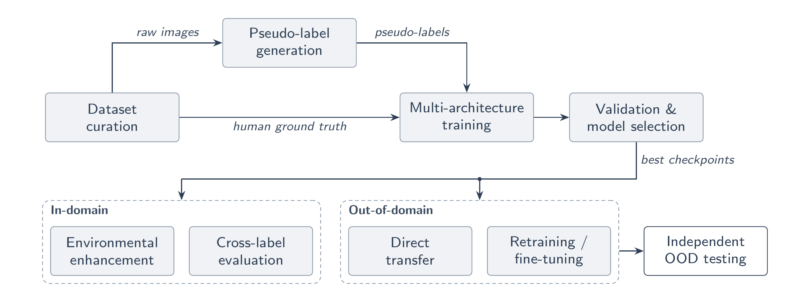

# Reducing Annotation Dependency for Underwater Fish Detection Through Open-Vocabulary Auto-Annotation

Code for my BSc Honours thesis (Rhodes University, 2026), supervised by Prof Dane Brown.

The project tests whether underwater fish detectors trained on boxes produced automatically by Grounding DINO can stand in for detectors trained on human-drawn boxes. Three detectors (YOLOv8s, YOLOv11x, RF-DETR-L) are each trained on three label sources (human, Grounding DINO tiny, Grounding DINO base) and evaluated on human labels, per sub-collection, and on the external DeepFish dataset.



## Key results

| | Value |
|---|---|
| Pseudo-labelling time (12,466 images, GD-tiny, RTX 4070) | 33.1 min (vs ≈1,270 h estimated manual) |
| GD boxes relative to human boxes (coverage, a count) | 76% |
| Human boxes matched by a GD-tiny box (IoU ≥ 0.5, validation, threshold 0.3) | 64% (precision 85%) |
| mAP50:95 on human test labels, human-trained | 0.63–0.66 |
| mAP50:95 on human test labels, GD-trained | 0.43–0.44 |
| Retention (GD-trained ÷ human-trained), mAP50:95 / mAP50 | 67–70% / 84–86% |
| Retention by sub-collection (mAP50:95) | 49% (Aldabra) to 75% (Pondoland) |

Full results are in `results/` and in the thesis.

## Data

The datasets are **not** stored in this repository.

- **SAIAB** (Aldabra Atoll, Lake Tanganyika, Pondoland MPA, Protea Banks), from the South African Institute for Aquatic Biodiversity, annotations by Daanyaal Salie: [Google Drive](https://drive.google.com/drive/folders/1AEPw0Rq0qYJuhENJVIH9cXhZwxgf9UBV)
- **DeepFish** (Saleh et al., 2020), with the bounding boxes of YOLO-Fish (Al Muksit et al., 2022), YOLO-format release: [Kaggle](https://www.kaggle.com/datasets/vencerlanz09/deep-fish-object-detection). It provides 3,596 training and 909 validation images with fish, plus 2,012 background images without fish. `prepare_deepfish.py` adds the background images to the validation split only (2,921 images).

All experiments use the SAIAB train/validation/test splits exactly as released (12,466 images; about 70/20/10 per sub-collection, split separately). The image filenames in each split are listed in `splits/`, so the exact partition can be checked or rebuilt.

| Sub-collection | Train | Validation | Test |
|---|---:|---:|---:|
| Aldabra Atoll | 1,337 | 381 | 191 |
| Lake Tanganyika | 1,790 | 518 | 267 |
| Pondoland MPA | 2,800 | 800 | 400 |
| Protea Banks | 2,776 | 808 | 398 |
| **Combined** | **8,703** | **2,507** | **1,256** |

Expected layout: one YOLO-format dataset per label source (`combined_hbb`, `combined_gd_tiny`, `combined_gd_base`), each with `train/`, `valid/` and `test/` folders containing `images/` and `labels/`, plus one folder per sub-collection (`aldabra_hbb`, `tanganyika_hbb`, `pondoland_hbb`, `protea_hbb`) for per-sub-collection evaluation.

## Repository layout

```
scripts/     all code used in the thesis (see below)
results/     result CSVs, evaluation outputs and training logs
splits/      image filenames in each SAIAB split
pipeline.png methodology overview (thesis Figure 3.1)
```

### Scripts by stage

| Stage | Scripts |
|---|---|
| Data preparation | `merge_datasets.py`, `prepare_deepfish.py` |
| Pseudo-labelling | `label_gd_tiny.py`, `label_gd_base.py` (prompt `"fish."`, threshold 0.3) |
| Threshold selection | `gd_threshold_sweep.py --split valid` |
| Training (9 models) | `training/`, run all with `run_all_training.sh` |
| DeepFish training | `train_v11x_deepfish_retrain.py`, `train_v11x_finetune.py`, `train_v11x_finetune_gdtiny.py` |
| Evaluation, YOLO | `run_cross_eval.py`, `run_subcollection_eval.py`, `run_deepfish_benchmark.py` |
| Evaluation, RF-DETR | `rfdetr_reeval.py`, `rfdetr_deepfish_chunked.py`, `run_deepfish_chunked.sh` |
| Out-of-domain models on SAIAB | `eval_ood_on_saiab.py` |
| DeepFish background images | `deepfish_negatives_eval.py` (fish-only / half / all background images, false alarms) |
| CLAHE probe | `run_clahe_eval.py` |
| Figures | `plot_training_curves.py`, `make_qualitative.py`, `make_slide_figs.py`, `visualise_labels.py`, `visualise_models.py` |

RF-DETR mAP reported in the thesis comes from `rfdetr_reeval.py` (predictions kept above confidence 0.001, matching Ultralytics `val`); it supersedes the RF-DETR numbers produced by the earlier evaluation scripts.

## Environment

Python 3.13, single NVIDIA RTX 4070 (12 GB). Main packages are pinned in `requirements.txt` (Ultralytics 8.4.37, rfdetr 1.7.1, transformers 5.5.3, supervision 0.28.0).

```bash
python -m venv fish_env && source fish_env/bin/activate
pip install -r requirements.txt
```

Scripts use absolute paths from the original server (`/mnt/LinuxBackup/jo/...`). Edit the path constants at the top of each script before running.

## Citation

J. H. Bahar, *Reducing Annotation Dependency for Underwater Fish Detection Through Open-Vocabulary Auto-Annotation*, BSc Honours thesis, Rhodes University, 2026.

## Acknowledgements

This work is based on the research supported in part by the National Research Foundation of South Africa (Ref Number PMDS250726348286).